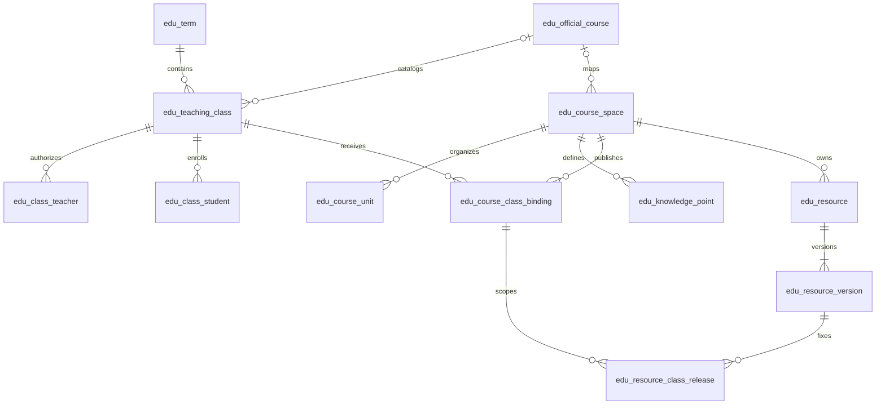

# MySQL V3.0 M0 教学业务数据库

> 2026-10-22 · 状态：DDL 已在 MySQL 8.0.43 实测；MySQL 8.0.46 未验证，待 8.0.46 环境复核；尚未部署到项目数据库

本设计以 [原始需求分析](../../智慧教育课程需求分析.docx)、[功能架构优化方案 V3.0](../../功能架构优化方案.md)和[教学业务架构](architecture.md)为输入。两段按顺序执行的 [核心表脚本](../sql/mysql-v3-m0-core-schema.sql)与 [教学闭环脚本](../sql/mysql-v3-m0-teaching-schema.sql)覆盖 V3.0 M0 教学业务，共 44 张表。它们不包含 `CREATE DATABASE`、若依系统表、真实人员数据和演示数据。项目数据库的部署仍需确认若依版本、身份/组织 ID 映射、备份、迁移执行人及回退方案。

## 1. 设计范围

物理表覆盖“教师建设课程空间 → 绑定教学班 → 发布指定版本资源 → 预习 → 同步课堂 → 签到/随堂题/课堂小作业 → 作业提交与正式评价 → 学习证据与统计 → AI 基础问答”。M1/M2 的证书、实训、AI 自动批改、个性化推荐与外部平台同步未纳入。身份、部门、角色与菜单沿用未来选定的若依基础工程。

| 领域 | 物理表 | 责任与用途 |
| --- | --- | --- |
| `course` | `edu_term`、`edu_official_course`、`edu_course_space`、`edu_course_unit`、`edu_knowledge_point` | 学期、正式课程目录、教师内容空间及教学单元 |
| `course` | `edu_teaching_class`、`edu_class_teacher`、`edu_class_student`、`edu_course_class_binding` | 教学班、任课与成员历史、课程空间按班绑定 |
| `resource` | `edu_resource`、`edu_resource_version`、`edu_resource_class_release` | 资源元数据、不可变的内容版本、按班发布与撤销 |
| `course` | `edu_lesson` | 课次归属教学班与课程空间 |
| `resource` | `edu_resource_page`、`edu_question`、`edu_question_version`、`edu_question_knowledge_point` | 课件转换页、题目和答案/量规版本 |
| `prepare` | `edu_lesson_plan`、`edu_plan_material`、`edu_activity_template` | 私有备课方案、材料顺序与活动预设 |
| `classroom` | `edu_class_session`、`edu_session_projection`、`edu_session_event` | 课堂状态、公开页快照及有序事件 |
| `activity` | `edu_activity_instance`、`edu_activity_target`、`edu_activity_response`、`edu_activity_response_revision` | 独立或课堂内签到/随堂题、目标快照与修订 |
| `assignment` | `edu_assignment`、`edu_assignment_item`、`edu_assignment_target`、`edu_assignment_submission`、`edu_submission_version`、`edu_submission_answer`、`edu_grade_revision`、`edu_grade_publication`、`edu_idempotency_record` | 预习测验、课堂小作业与课后作业共用提交/评价链路 |
| `learning` | `edu_learning_event`、`edu_video_watch_interval`、`edu_wrong_question` | 去重事件、视频区间和错题证据 |
| `analysis` | `edu_metric_snapshot` | 带口径、时间、分母与来源水位的统计快照 |
| `ai` | `edu_ai_task`、`edu_ai_citation` | 基础问答任务、模型/模板版本、授权资源出处 |
| `course` | `edu_course_announcement`、`edu_user_notice` | 课程公告与师生待办/反馈通知 |

账号、角色、部门和菜单由选定的若依基础工程提供。本方案的 `user_id`、`organization_id` 是逻辑引用；接入真实基础工程前核对其 ID 类型、组织模型与授权接口，不在此伪造系统表或跨模块外键。

## 2. 核心关系

上图展示第一段脚本的课程与资源骨架；第二段脚本在 `edu_course_class_binding` 之下延伸课次、备课、课堂、活动、作业、学习证据、统计和 AI。`edu_teaching_class` 以组织、学期和班级编码唯一定位。正式课程目录可关联多个教学班，课程空间可发布到多个教学班；同一班是否允许同时绑定多个课程空间尚待业务确认，因此当前只限制同一“班级 + 课程空间”不能重复处于有效绑定状态。课程空间和绑定均记录 `organization_id`，复合外键要求绑定的教学班、课程空间、学期和正式课程属于同一组织；跨组织共享须另设明确授权关系。

## 3. MySQL 物理规则

- 脚本语法面向 MySQL 8.0.16 或更新版本的 InnoDB，使用 `utf8mb4`、`CHECK`、生成列和外键；DDL 已在 MySQL 8.0.43 实测；MySQL 8.0.46 未验证，待 8.0.46 环境复核。最终部署版本需与选定若依工程一起确认；低版本不能直接使用。MySQL 从 8.0.16 起支持执行 `CHECK` 约束：[官方说明](https://dev.mysql.com/doc/refman/8.0/en/create-table-check-constraints.html)。
- 教学表主键暂用有符号 `BIGINT AUTO_INCREMENT`，与若依用户 ID 的实际类型在接入前核对。业务编码不是主键；ID 在 API 中如何表示仍需前后端评审。
- 时间列使用 `DATETIME(3)`，服务端和数据库连接按 UTC 写入、比较，界面按用户时区显示。业务截止以服务端时间为准；部署时验证连接时区和迁移会话时区。
- 删除策略以状态、结束时间和受控归档为主。历史成员、绑定、资源版本和发布记录不做级联物理删除；保留期限和依法删除流程待学校确认。
- `valid_to` / `left_at` / `ended_at` 为空表示记录尚未显式结束。带唯一索引的生成列只对未结束记录产生非空值，因而阻止重复成员、绑定及资源发布，同时保留多条结束后的历史。资源发布的 `closes_at` 是访问截止时点，不会自动释放唯一键；到期后由受控任务或下一次发布事务将旧记录设为 `EXPIRED`，再插入新发布。MySQL 唯一索引允许多个 `NULL`：[官方说明](https://dev.mysql.com/doc/refman/8.0/en/create-index.html)。
- 任课授权以 `valid_from` / `valid_to` 记录有效期；角色或发布、评分、导出权限变化时，关闭旧授权并新增一条记录，保留授权人、结束人和原因。学生入退班、课程绑定结束、资源发布到期/替换/撤销同样保留操作者及原因；不原地改写历史权限。
- 唯一索引只防止同时存在两条未结束的关系；已结束记录的时间区间是否重叠，仍需由服务端在事务中校验并留审计记录。教学班到学期、正式课程，以及课程空间和绑定的复合外键同时核对组织 ID。正式教学班与课程空间的 `official_course_id` 是否必须相同仍待业务确认，当前由服务端评审后校验。
- 仅对教育业务表内部引用建外键。资源发布表用复合外键保证“发布绑定、资源、资源版本”属于同一个课程空间；用户身份、组织归属、教师是否有发布权和成员是否当前有效仍由服务端在事务内校验。
- 教学单元的父子关系由复合外键限定在同一课程空间；循环层级由服务端阻止。MySQL 不允许 `CHECK` 引用自增列，因此不在 DDL 中用 `id` 表达自父级校验：[官方说明](https://dev.mysql.com/doc/refman/8.0/en/create-table-check-constraints.html)。
- 文件字节不进入 MySQL；版本表仅存私有对象键、摘要、大小和处理状态。版本的 `resource_kind` 与资源本体通过复合外键保持一致，`FILE` 只能使用 `storage_key`，`LINK` 只能使用 `external_uri`；课件预览页只能属于文件版本。下载地址由服务端临时签发并再次鉴权，不能将 `storage_key` 当作公开 URL。若外链不受平台控制，无法保证撤权后失效，不能将其用于要求访问控制的私有课件。
- 预习使用 `edu_assignment.assignment_kind = PREVIEW`，课堂小作业使用 `CLASSWORK`，课后作业使用 `HOMEWORK`；三者共用目标、提交版本、评分和发布链路。签到与随堂题使用 `edu_activity_instance`，不复制教师端/学生端数据。目标表引用具体入班记录，并通过复合外键限定在同一教学班和学生。
- 题干、答案、解析及评分量规固定在 `edu_question_version`，作业项引用指定版本。学生端和 AI 检索只允许通过服务端按发布时间取出可公开字段。自由文本题的 `prompt` 在作业发布后由服务端冻结；版本表/已发布行的禁止修改需要应用权限与数据库账号策略配合，DDL 本身不保证行不可变。
- 课堂当前公开页以 `(session_id, state_seq)` 的快照读取；`edu_session_event` 按会话内 `seq_no` 唯一。重连先读快照，再补事件；事件的 `PUBLIC` 载荷只能由服务端裁剪后写入。活动 `OPEN` 状态用生成列限制一个教学班同一时刻最多一个签到和一道随堂题；截止时由服务端事务显式关闭，时间列本身不会改变唯一键。
- 成绩草稿在 `edu_grade_revision`，确认后才允许被 `edu_grade_publication` 的复合外键引用；公布、撤回、更正保留发布版本。发布的评分必须对应同一提交版本。AI 任务和引用没有写入正式成绩的外键路径；建议必须经教师人工确认再由作业服务处理。
- `edu_learning_event` 的 `source_kind/source_id` 是多来源证据引用，无法用单一外键表达，服务端必须检查来源存在、所属教学班和学生权限。视频区间可重叠，聚合时须去重。`edu_metric_snapshot.metric_value` 在分母为零或证据不足时保持 `NULL`，不能冒充零表现。

## 4. 读写与授权边界

**发布资源时**，服务端先校验任课教师当前权限、教学班与课程空间绑定、资源归属及版本处理状态；在同一业务事务中固定 `resource_version_id` 并写入发布记录。同一绑定再次发布同一资源时，先将旧发布按 `EXPIRED`、`REPLACED` 或 `REVOKED` 显式结束，再插入新发布；旧记录及其版本引用不改写。截止时间已过但尚未结束的旧发布仍占用唯一键，不能用“撤销”冒充正常到期。

**学生访问时**，服务端同时检查学生当前班级成员关系、绑定未结束、资源发布未结束、开放和截止时间、版本为可用状态。只找到资源 ID、拥有页面菜单或持有旧下载链接都不足以授权。成员退出或发布结束后，新请求失去访问资格；历史学习与成绩记录按照保留政策单独处理。

**并发时**，唯一索引负责拦截重复的有效关系；服务端捕获冲突后读取已有记录或返回明确冲突。状态更新使用原状态或版本条件并检查受影响行数，不能靠前端按钮防重。跨表外键保证存在性，但不代替业务授权或状态转移。

**发布预习/作业和发起活动时**，同一事务中冻结题目版本、时间规则和目标学生快照；事后豁免与目标调整记录操作者和原因。提交事务以目标唯一约束、幂等键、服务端截止时间及显式版本号联合判定。新提交先结束旧有效版本，再写新版本。成绩修订只引用指定提交版本；教师确认与正式发布是两次有权限校验的操作。

**同步课堂与 AI 时**，公开页只引用本班已发布的资源版本与转换页；连接建立、重连、补事件均重新校验成员身份。AI 创建任务前和引用返回前分别核对当前授权、资源开放期、答案公布时点和角色可见字段；历史 `edu_ai_citation` 只是审计出处，不自动授权再次读取。AI 超时或失败不阻塞课堂、作业与资源阅读。

## 5. M0 验收场景

1. 一个课程空间可以绑定多个教学班；同班同空间并发绑定只保留一条有效记录，结束后可新增历史绑定。
2. 同一学生退班后再次入班形成新成员记录；有效成员唯一，旧参与证据仍可追溯。
3. 资源版本 1 已发布给甲班时，上传版本 2 不改写甲班原发布；乙班不能凭资源 ID 读取甲班发布内容。
4. 资源不属于绑定的课程空间、版本不属于该资源、教师无任课授权或学生已退班时，写入或读取均被拒绝。
5. 未就绪版本、尚未开放、已经截止或已撤销的发布不向学生开放。
6. 甲组织的教学班不得关联乙组织的课程空间；资源到期后同一绑定可再次发布该资源，旧发布按 `EXPIRED` 保留，替换与主动撤销分别留因。
7. 乙班学生的入班记录不能成为甲班活动或作业的目标；一个教学班同类签到/随堂题不能同时有两个 `OPEN` 实例。
8. 草稿评分不能发布；正式发布只能引用同一提交版本的已确认评分。改交、改分和成绩撤回保留历史版本。
9. 断线重连按课堂快照序号补事件；公开事件不包含教师私有备注、隐藏答案或学生明细。AI 引用属于本教学班的已授权发布版本，并在结果返回时再次鉴权。

[约束验证脚本](../sql/verify-v3-m0-invariants.sql)曾记录在隔离 MySQL 8.0.46 测试库执行；当前环境无 8.0.46，未复核，待 8.0.46 环境重跑。脚本覆盖跨组织绑定、资源类型、重复发布/到期重发、跨班目标、同班双开随堂题、草稿评分、提交版本错配、错题归属、课堂事件序号与 AI 出处外键。第 4、5、9 项还需要服务端与实时连接实现后做集成测试；当前只有 6-02 教师公告的基础 Service 和 H2 隔离测试，没有 MySQL、HTTP 或真实教学班授权联调。

## 6. 首版覆盖边界与应用层责任

| 边界 | 当前落库方式 | 后续服务责任 |
| --- | --- | --- |
| 若依账号、部门、角色、菜单 | 教学表中的 `user_id`、`organization_id` 为逻辑引用 | 核对实际 ID 类型、停用/调班、账号归属与数据权限；不把部门权限直接等同班级授权 |
| 资源对象与 PPT 转换 | 私有对象键、处理状态、逐页预览键 | 上传检查、异步转换、失败重试、受控签名 URL、撤权后的下载鉴权 |
| 实时连接 | 会话状态、公开页快照和有序事件 | WebSocket/SSE/补查方案、断线恢复、事件裁剪、失效连接撤权 |
| 开放/截止/并发 | 时间、状态和未结束唯一键 | 用服务端 UTC 时间、事务和定时/懒关闭控制；到期不会自动更新行 |
| 发布快照 | 题目/资源版本和目标名单 | 发布事务冻结行；目标调整、补签/补答、迟交、改交规则逐项校验 |
| 学习与统计 | 来源事件、视频区间、指标快照 | 去重/区间并集、指标定义版本、样本下限、授权聚合与重算 |
| AI M0 | 问答任务、模型/模板版本、引用来源与用量字段 | 供应商接入、敏感正文保留期限、检索前后授权、结果降级；M1 自动批改另行设计 |

证书、实训、深度 AI 备课/批改、个人能力推断、外部教务同步属于后续范围；不能因为管理端存在菜单就把其当作 M0 已实现能力。

## 7. 待评审决定

1. 确定项目 MySQL 具体版本、迁移工具、部署和备份恢复要求；隔离测试仅证明当前 DDL 可执行与列出的约束行为。
2. 对齐若依的用户/部门 ID、账号停用机制、数据权限范围及跨模块事务边界。
3. 确认教学班是否可同时绑定多个课程空间、正式与体验班规则、协同教师可回收的具体权限。
4. 确认资源类型、审核、转换、下架、下载时效与历史版本保留期限。
5. 确认成员变动、资料和学习记录的保留/删除政策；定义迁移回退和不可逆操作的恢复方式。

两段脚本已可在空数据库按顺序执行；接入真实若依及业务服务前仍须评审并确定正式迁移编号、部署与回退。当前脚本和隔离测试不代表已在项目数据库部署，也不代表业务功能已完成。
